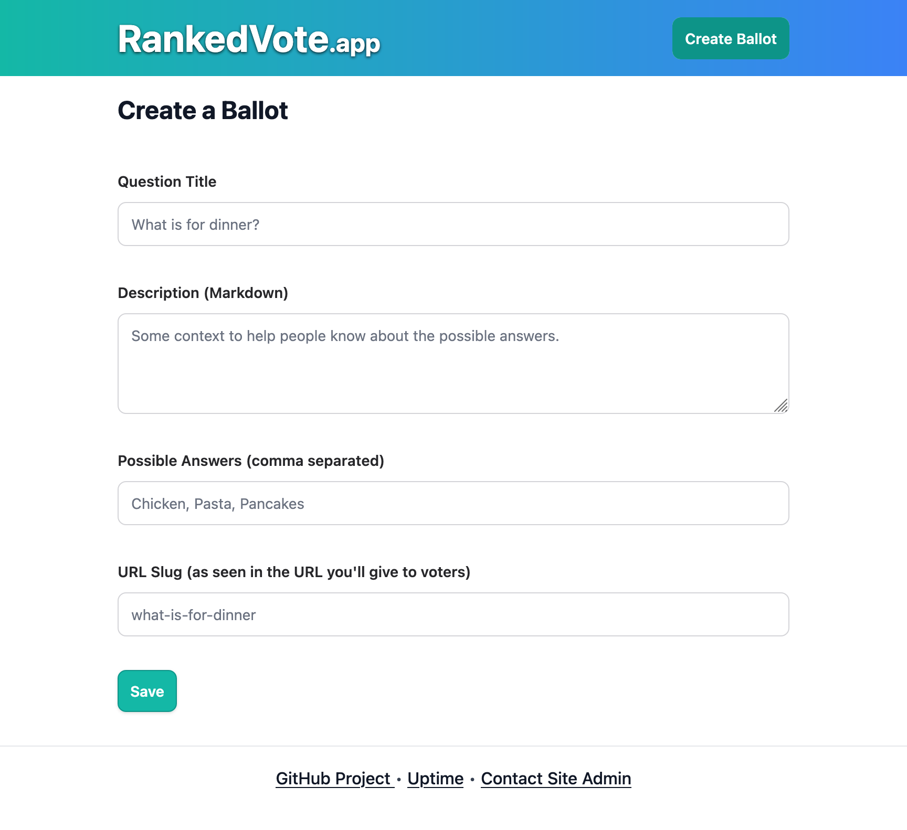
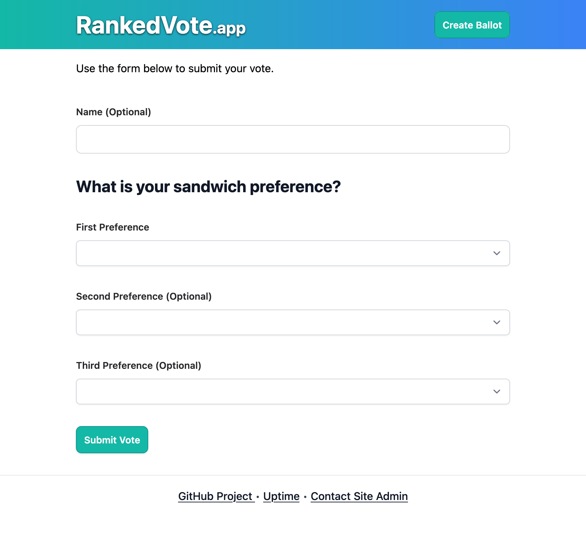

# Flick


Flick is a simple Elixir / Phoenix LiveView app that helps capture ranked votes. You can see this project in action at <https://rankedvote.app/>.

This project was built to help the [Elixir Book Club](https://elixirbookclub.github.io/website/) pick books, but it is open to all.

## Highlights

- No accounts are needed to create ballots or cast votes.
- Votes are ranked votes that help find a better overall consensus.
- Individual voters can be weighted.
- A ballot can be closed, stopping future votes from being cast.

## Notable Future Enhancements

- The project is very trusting and has no aggressive security against people voting more than once. Flick is intended for honest polling.
- See [Issues](https://github.com/zorn/flick/issues) for more.

## Project Demo

YouTube: <https://www.youtube.com/watch?v=pxE6AbaQuUM>

## Screenshots







## Running in Local Development

### Prerequisites

- [asdf](https://asdf-vm.com/guide/getting-started.html), for the Erlang and Elixir versions pinned in `.tool-versions`.
- [Docker](https://docs.docker.com/get-started/get-docker/) with Compose, for the Postgres database.

You do not need Postgres installed on your machine.

### First run

From the project root:

```bash
asdf install           # install Erlang and Elixir
docker compose up -d   # start Postgres 18 on port 5418
mix setup              # fetch deps, create and seed the database, build assets
mix phx.server         # or `iex -S mix phx.server`
```

Visit [`localhost:4000`](http://localhost:4000). The seeds in `priv/repo/seeds.exs` create a few sample ballots. The admin pages under [`/admin`](http://localhost:4000/admin/ballots) use the HTTP Basic Auth credentials `flick-admin` / `unsafe-password`.

Run the tests with `mix test`, and run every check CI runs with `mix precommit`.

### The database

`compose.yml` runs Postgres 18, the same major version as production, on port 5418. Flick connects only to that port, so another Postgres on the default port 5432 is never used. To use a different port, set `POSTGRES_PORT` for both `docker compose` and `mix`.

Dev and test refuse to start when the server is not Postgres 18, so a stray server cannot stand in for the container unnoticed.

- `bin/psql` opens `psql` on the dev database inside the container. Extra arguments go to `psql`, as in `bin/psql -c "select count(*) from ballots"`. Any `psql` 18 client on your machine also works, such as the one in Homebrew's `libpq`, with `psql -h localhost -p 5418 -U postgres flick_dev` and the password `postgres`.
- `mix ecto.reset` drops the dev database and rebuilds it from the seeds.
- `docker compose down` stops the container and keeps its data. `docker compose down -v` also deletes the data.

Development runs on the seed data. If you ran Flick against another Postgres server before, its data does not move over, and `mix setup` starts you fresh from the seeds.

### Debugging with a production backup

This is rare and always manual. Use a production backup only to debug something the seed data cannot reproduce, and never as part of normal development.

Download a backup from the database's Recovery page in the Render dashboard. It is a `.dir.tar.gz` archive of a directory-format `pg_dump`. Restore it into its own database, so `flick_dev` keeps the seed data:

```bash
tar -xzf 2026-10-21T13_00Z.dir.tar.gz
docker compose exec db createdb --username=postgres flick_prod_copy
docker compose cp 2026-10-21T13_00Z.dir db:/tmp/restore
docker compose exec db pg_restore --username=postgres --dbname=flick_prod_copy --no-owner --no-privileges /tmp/restore
docker compose exec db rm -rf /tmp/restore
DEV_DATABASE_NAME=flick_prod_copy mix phx.server
```

The backup holds real voter data. When you are done, drop the database with `docker compose exec db dropdb --username=postgres flick_prod_copy`, and delete the archive and its extracted directory.

Ready to run in production? Please [check our deployment guides](https://hexdocs.pm/phoenix/deployment.html).

### Parallel worktrees (optional)

Flick is set up for [worktrunk](https://worktrunk.dev) (`wt`), which creates git worktrees so that several copies of the app, or several coding agents, can run side by side. Nothing above depends on it. A normal checkout ignores these files and keeps port 4000 and the `flick_dev` database.

A worktree made with `wt` gets its own copy of `_build` and `deps`, its own port, and its own dev and test databases. Every worktree shares one Compose container, because `compose.yml` fixes the project name. Start it once with `docker compose up -d` from any checkout. The port and database names are in the worktree's `.env.worktree`, which `config/runtime.exs` reads.

Set up each machine once with [the runbook's setup steps](https://github.com/zorn/dotfiles/blob/main/worktrunk/README.md#set-up-each-machine-once). Flick's `.config/wt.toml` calls a hook script installed by those steps. Without it, `wt` reports an error and leaves the worktree without its databases, and `mix` in that worktree refuses to start rather than fall back to `flick_dev`.

Create and remove these worktrees only with `wt`, because its hooks create the databases and drop them again. A worktree removed any other way leaves its databases behind. [The worktree runbook](https://github.com/zorn/dotfiles/blob/main/worktrunk/README.md) in zorn/dotfiles covers the full flow: setup, creating and opening a worktree in Herdr, working in it, removing it, and what to do when removal stops.

## Learn more

  * Official website: https://www.phoenixframework.org/
  * Guides: https://hexdocs.pm/phoenix/overview.html
  * Docs: https://hexdocs.pm/phoenix
  * Forum: https://elixirforum.com/c/phoenix-forum
  * Source: https://github.com/phoenixframework/phoenix
